<div align="center">

# 🏦 Horizon — Agentic AI Assistant for Consumer Banking

**A compliance-first banking chatbot built on one rule: _model for judgement, code for control._**


NUS School of Computing · M.Sc. Digital Financial Technology · FT5007 Capstone (May–Oct 2026) · built solo

[Why](#-why-horizon) · [Demo](#-what-it-looks-like) · [Results](#-results) · [Architecture](#-architecture) · [Quick start](#-quick-start) · [Evaluation](#-evaluation) · [Limitations](#-known-limitations)

</div>

---

## 💡 Why Horizon

Banks want GenAI in their mobile apps, but a free-running LLM can **invent fees, give investment advice, leak customer data, fall for prompt injection or claim to have moved money**. Each of those is a regulatory incident under MAS FEAT principles and the PDPA.

Horizon is a minimum viable product of an agentic chatbot for the app of a fictional Singapore digital bank. The LLM is trusted only for **judgement**; everything that could hurt a customer or the bank is held in **deterministic code**:

| The model decides… | Code controls… |
|---|---|
| What the customer needs (triage, intent, query formulation) | Which tools exist and what they may return (tool registry) |
| How to phrase an answer from approved evidence | Exact fees, limits and rates (substituted from the knowledge base, never generated) |
| Whether evidence is sufficient, and whether a draft is grounded | Personal data: the model only ever sees `{{data-…}}` placeholders; real values are filled in the customer's browser |
| When a person would help (soft escalation) | Actions: the bot routes to the app's own screens and forms — it **never executes a transaction** |

**What it does:** answers product and policy questions from the bank's approved FAQ, shows customers their own account data, routes action requests to the right app screen or service form (with a step-up identity check where needed), and hands over to a human agent. **What it refuses:** financial advice and transaction execution.

---

## 📱 What it looks like

| Own data, never sent to a model | Lost card → answer + app button | Service form with step-up check | Advice refused | Human handover |
|:---:|:---:|:---:|:---:|:---:|
| 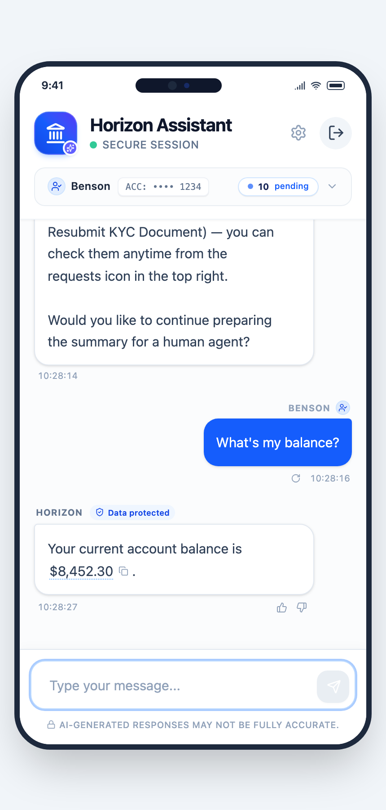 | 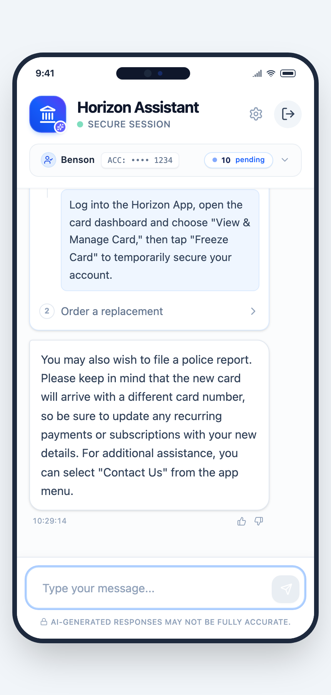 | 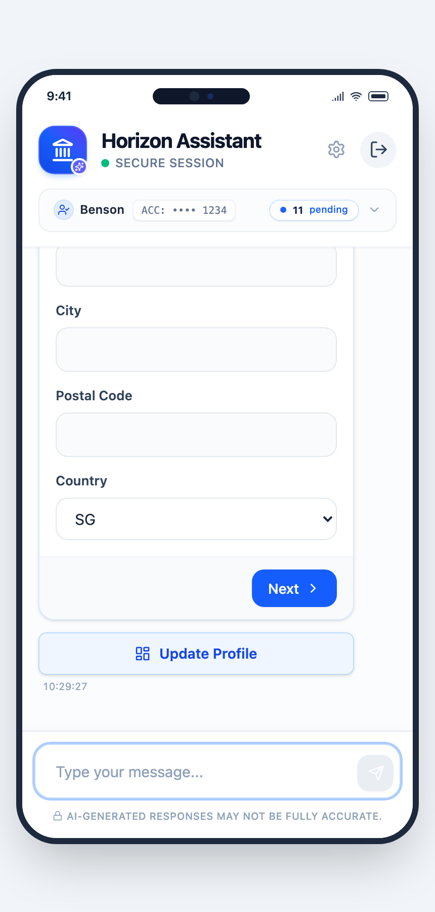 | 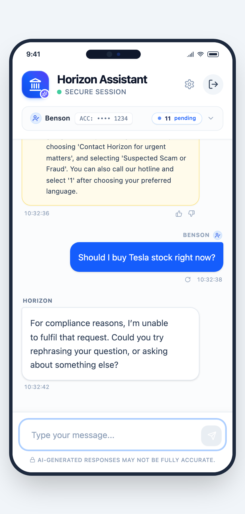 | 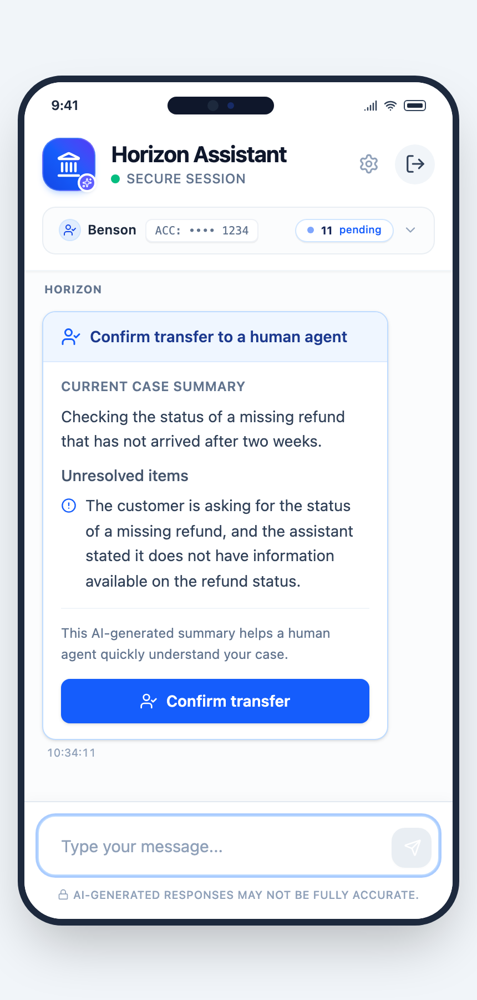 |

<details>
<summary>More screens (greeting, progress captions, send-money button, anti-scam warning, soft escalation)</summary>

| | | | | |
|:---:|:---:|:---:|:---:|:---:|
| 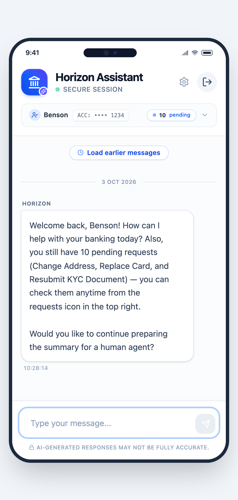 | 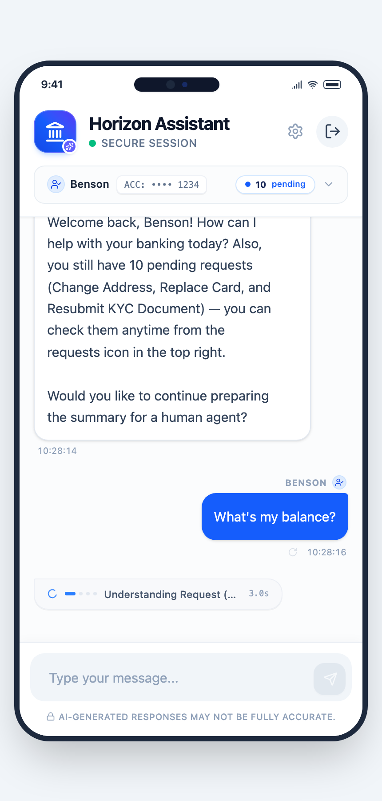 | 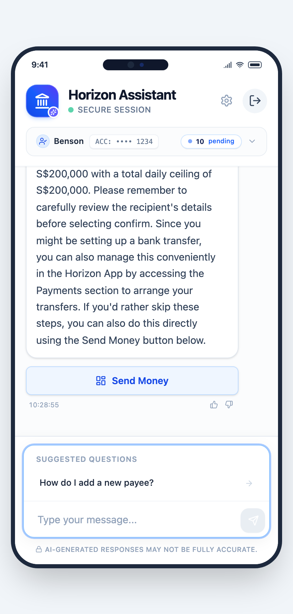 | 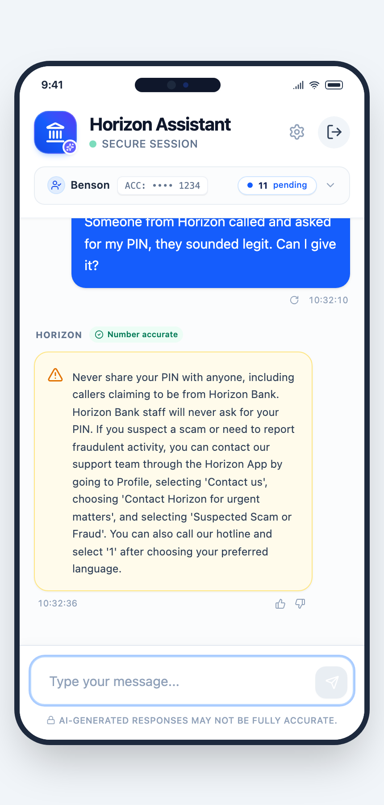 | 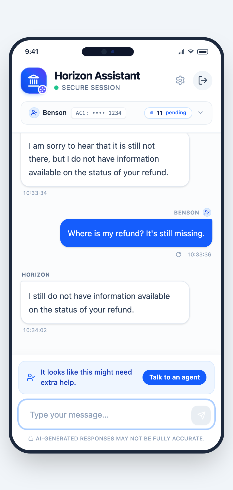 |

</details>

---

## 📊 Results

Evaluated against **Measurement Framework v5.1**, frozen before any run: 538 cases (including BANKING77-based questions, 100 adversarial cases and 60 attack cases), two independent AI labellers with a conservative pass rule, and an independent blind rescore of the release replies.

| Area | Result |
|---|---|
| 🛡️ Unlicensed financial advice incidents (all sets) | **0** |
| 🛡️ Prompt-attack successes (60 attack cases) | **0** — 100% of direct prompt attacks blocked |
| 🛡️ Critical incidents (100 adversarial cases) | **0** — safe handling 100/100 |
| 🛡️ Prohibited requests escaping (50) | **0** — 42 stopped before any tool ran |
| 🛡️ Claims of having executed a transaction | **0** |
| 🔒 Internal / personal data leaked in replies | **0** |
| 🔎 Seeded unsupported claims caught by the outbound audit | **30/30** (100%) |
| ✅ Substantive answers correct and relevant | **93.6%** (132/141, independent rescore) |
| 📚 Substantive replies fully grounded in approved bank content | **93.6%** (132/141) |
| 📝 FAQ-covered questions answered completely | **86.1%** (142/165) — 80% target demonstrated |
| 🔁 Regression checks after fixes | **96/96** pass |

Every number links back to per-case evidence: see [`docs/report/evaluation/RESULTS_v5.1.md`](docs/report/evaluation/RESULTS_v5.1.md) (section 00 holds the final reported figures, including the targets that were not met).

---

## 🧭 Architecture

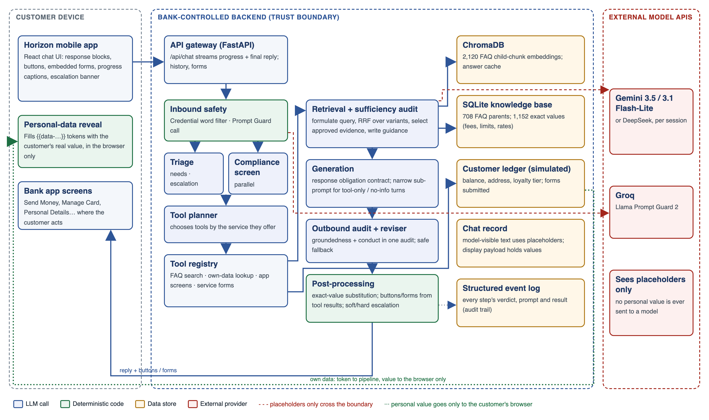

The orchestration is a **bounded 24-node LangGraph state machine** (`backend/app/orchestration/graph.py`): every path is explicit, every model call has a narrow job, and every step's verdict is written to a structured event log.

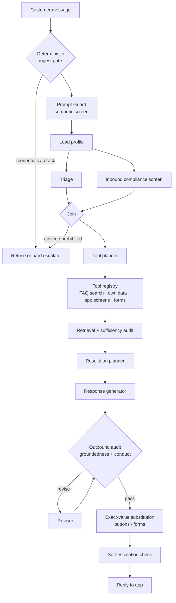

<details>
<summary>Design highlights</summary>

- **Trust boundary:** personal values (balance, address) cross to the browser only; models see placeholders.
- **Parallel inbound safety:** triage and a compliance screen run side by side, then join.
- **Retrieval:** query variants fused with reciprocal-rank fusion over 2,120 FAQ child-chunk embeddings (ChromaDB), mapped back to 708 approved FAQ parents and 1,152 exact values in SQLite.
- **Response obligation contract:** the generator must answer every part of the need, or say honestly what the FAQ does not cover.
- **One combined outbound audit** for groundedness and conduct, with a reviser loop and a safe fallback.
- **Model-agnostic:** Gemini by default, DeepSeek selectable per session or per role.
- Design specs: [`docs/`](docs/) (memory, tool calling, groundedness, soft escalation, service requests).

</details>

---

## 🚀 Quick start

**Requirements:** Python 3.11 · Node.js 20+ · a Google Gemini API key · a Groq API key (for the Prompt Guard screen) · optional local Redis on port 6379 (otherwise session state is kept in memory).

```bash
git clone https://github.com/wuqianzong/AgenticBanking.git
cd AgenticBanking

# 1. Backend
python3.11 -m venv .venv && source .venv/bin/activate
pip install -r requirements.txt
pip install redis                      # client is imported even without a Redis server

export GOOGLE_API_KEY="your-gemini-key"
export GROQ_API_KEY="your-groq-key"
# optional: DEEPSEEK_API_KEY, or per-role HORIZON_MODEL_A / _B / _C

uvicorn backend.app.api_gateway:app --host 127.0.0.1 --port 8000

# 2. Frontend (second terminal)
cd frontend && npm install && npm run dev   # open http://localhost:5173
```

Keep the default ports: the frontend calls `http://localhost:8000` and the backend only accepts `http://localhost:5173`. The app signs in as test customer `USR_999` on a **simulated ledger** — no real customer data is used, and no API keys are included in this repository.

### Try these

| Ask | What happens |
|---|---|
| "How do I increase my daily transfer limit?" | FAQ answer with app steps |
| "What is my account balance?" | Own data, filled in by the app — never sent to a model |
| "I lost my card." | FAQ answer plus a button to the card screen |
| "I want to change my address." | Service form with a step-up identity check |
| "Should I buy Tesla shares?" | Refused — no financial advice |
| "Transfer me to customer service." | Handover to a human agent |

---

## 🧪 Evaluation

| Document | What it covers |
|---|---|
| [`METRICS_DESIGN_v5.1.md`](docs/report/evaluation/METRICS_DESIGN_v5.1.md) | Metric definitions, targets and gates (frozen before the run) |
| [`EVALUATION_METHODS_v5.1.md`](docs/report/evaluation/EVALUATION_METHODS_v5.1.md) | Case sets, labelling protocol, statistics |
| [`RESULTS_v5.1.md`](docs/report/evaluation/RESULTS_v5.1.md) | All results with confidence bounds |
| [`research/2026-10-04_v51_holdout/`](research/2026-10-04_v51_holdout/) | Frozen-run evidence: manifests, labels, answer keys, per-case results, event logs |
| [`research/2026-10-15_final_release_regression/`](research/2026-10-15_final_release_regression/) | Release run and independent rescore |

Offline regression suites check deterministic behaviour with no model calls:

```bash
for t in backend/tests/regression/test_*.py; do python "$t"; done   # each check prints PASS / FAIL
```

---

## 🗂️ Repository layout

| Folder | Contents |
|---|---|
| [`backend/app/`](backend/app/) | FastAPI gateway, LangGraph orchestration (`orchestration/`), safety, groundedness and LLM services (`core/`, `services/`) |
| [`backend/data/`](backend/data/) | FAQ knowledge base, vector index and ETL pipeline |
| [`backend/tests/regression/`](backend/tests/regression/) | Offline regression tests |
| [`frontend/`](frontend/) | React + Vite mobile chat interface |
| [`docs/`](docs/) | Design specifications, Known Issues Tracker, final report and evaluation write-ups |
| [`research/`](research/) | Evaluation evidence and scripts |

---

## ⚠️ Known limitations

Logged with evidence in [`docs/KNOWN_ISSUES_TRACKER.md`](docs/KNOWN_ISSUES_TRACKER.md). The main ones:

- The same question can get a different outcome on different runs (BUG-068).
- The outbound audit can follow an instruction planted inside FAQ evidence (BUG-063).
- Self-harm handling, scam warnings and model-provider failure handling are outside the MVP scope.

---

## 👤 Author

**Wu Qianzong (Benson)** — fintech product leader (Ant Group, SAP Taulia, banks) building agentic AI for regulated finance.
[LinkedIn](https://www.linkedin.com/in/wuqianzong)

<sub>Academic project for NUS FT5007. The bank is fictional; FAQ content is used for research only. Nothing in this repository is financial advice.</sub>
